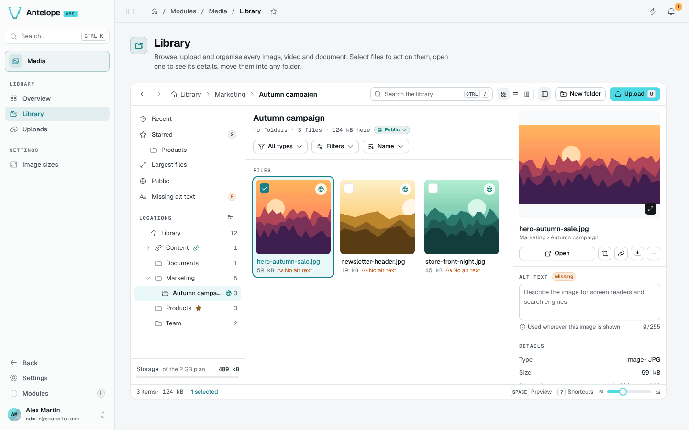

<div align="center">

# @antelopejs/dms-media

<a href="https://www.npmjs.com/package/@antelopejs/dms-media"></a>
<a href="./LICENSE"></a>
<a href="https://discord.gg/sjK28QHrA7"></a>
<a href="https://dms.antelopejs.com/docs/modules/media"></a>

A media library for the [AntelopeJS DMS](https://github.com/AntelopeJS/dms): uploads, folders, image sizes and light editing.

</div>



## What it does

- Organises images, videos and documents in a Finder-style explorer, with smart views, search, drag and drop and bulk actions.
- Uploads files straight to the project's file storage and delivers them from stable `/media/<id>/<name>` URLs.
- Renders named image sizes on first request, with crop and rotation that can revert to the original.
- Applies per-folder rights built on the DMS permissions and roles.
- Adds an `AssetType` form field, from [`@antelopejs/interface-dms-media`](./packages/interface-dms-media), that opens the library as a picker on your pages.
- Lets a project ship folders and files as code with `EnsureMediaFolder` and `ImportMediaAsset`, created once and never overwriting what members changed.

## Install

Run the AntelopeJS CLI from the root of a project that already loads `@antelopejs/dms` and a file storage module:

```bash
ajs project modules add @antelopejs/dms-media
```

## Quick start

Point the module's links at the API's public URL, and allow the dashboard's origin, since the browser uploads straight to the storage:

```ts
// antelope.config.ts
"dms-media": {
  source: { type: "package", package: "@antelopejs/dms-media", version: "^0.4.0" },
  config: {
    publicBaseUrl: "${@api.API_PUBLIC_BASE_URL}",
  },
},
api: {
  config: {
    cors: { allowedOrigins: ["https://dms.example.com"] },
  },
},
```

Restart the backend, then the frontend, and open **Modules › Media** (`/modules/media/overview`). To let members pick files from your own pages, add an asset field:

```ts
import { AssetType } from "@antelopejs/interface-dms-media";

new AssetType({
  mimetypes: ["image/*"],
  binding: { id: "articles.cover", folderName: "Article covers", permissionsFromPage: ArticlesPage },
});
```

## Compatibility

| Package | Version |
| --- | --- |
| `@antelopejs/dms` | `>=0.11.0 <1.0.0` |
| `@antelopejs/interface-dms` | `>=0.9.0 <1.0.0` |
| `@antelopejs/dms-frontend` (renderer) | `>=0.9.1 <0.10.0` |
| `@antelopejs/interface-dms-media` | `>=0.2.1 <0.3.0` |
| File storage | an `@antelopejs/interface-file-storage` implementation, such as `@antelopejs/file-storage-local` |

On DMS 0.8, use `@antelopejs/dms-media` 0.3.

## Packages

| Package | Directory | Role |
| --- | --- | --- |
| [`@antelopejs/dms-media`](https://www.npmjs.com/package/@antelopejs/dms-media) | [`packages/dms-media`](./packages/dms-media) | The module: library, uploads, delivery, image sizes and editor. |
| [`@antelopejs/interface-dms-media`](https://www.npmjs.com/package/@antelopejs/interface-dms-media) | [`packages/interface-dms-media`](./packages/interface-dms-media) | The interface consumers use: the `AssetType` field, folder bindings and declared content. |

## Documentation

- [Consumer reference](./packages/interface-dms-media/docs/1.index.md)
- [Introduction](https://dms.antelopejs.com/docs/modules/media/introduction)
- [Installation](https://dms.antelopejs.com/docs/modules/media/installation)
- [Configuration](https://dms.antelopejs.com/docs/modules/media/configuration)
- [Usage](https://dms.antelopejs.com/docs/modules/media/usage/overview)
- [Extending](https://dms.antelopejs.com/docs/modules/media/extending)
- [FAQ](https://dms.antelopejs.com/docs/modules/media/faq)

The guide's sources live in [`packages/dms-media/docs`](./packages/dms-media/docs). The module ships the `dms-media` Claude Code skill in [`packages/dms-media/skills`](./packages/dms-media/skills), declared under `antelopeJs.skills`.

## Contributing

Read [CONTRIBUTING.md](./CONTRIBUTING.md) before opening a pull request. The playground is a project of its own, outside the workspace, and links the interface package from the tree. It connects to MongoDB at `mongodb://localhost:27017` unless `MONGO_URL` is set.

One install from the repository root includes the backend, interface and shipped Vue frontend. The root lockfile covers this workspace; the frontend retains its lockfile for standalone consumers. The playground still needs a separate install for local development.

```bash
pnpm install --frozen-lockfile
pnpm --dir packages/dms-media/playground install --frozen-lockfile --ignore-workspace
pnpm dev            # builds the interface, the module and the playground, then starts the backend
pnpm frontend:dev   # dashboard, in a second terminal
pnpm lint
pnpm typecheck
pnpm knip
pnpm test           # frontend unit tests
pnpm --dir packages/dms-media test  # backend unit and integration suites
pnpm test:frontend  # typechecks the frontend layer against the DMS layer
pnpm run checks     # typecheck, lint, format, knip, tests, size, ratchet and sync
```

<details>
<summary>Repository notes</summary>

- The playground's Media demo page (`/media-demo`) holds every flavour of the `AssetType` picker: a single cover image with a linked folder, a gallery with a maximum, a PDF-only spec sheet, restricted documents in their own folder, and a free attachment.
- The frontend entry is `frontend-vue/dms.frontend.ts`. It declares the `DmsMedia` component prefix and registers the blocks of `app/components/*.vue` by file name (`Explorer` is served as `DmsMediaExplorer`); the parts in subfolders are imported by path. `dms.frontend.build.ts` auto-imports `app/composables` and `app/utils`. Use relative imports for module-local files, because the renderer copies the frontend separately from the backend.
- The blocks read the data they render with the DMS's `useApiData`, and the explorer's file listing with `useApiPagedData`. Writes, downloads, the asset field's entries, the dialogs and the image editor's canvas stay `$authFetch` calls in the browser.
- The file links (`/media/<id>/<name>`) are served by the backend: the module declares `/media/**` as a backend prefix with the session (`backendProxies`), so a private file opens for a signed-in member.
- Release the interface first (`release-interface.yml`), then the module (`release.yml`), which checks that the interface version in the tree is already on npm. `pnpm --dir packages/dms-media test:reload` checks the hot reload of a consumer and of the module in a real project.

</details>

## License

[Apache-2.0](./LICENSE)
