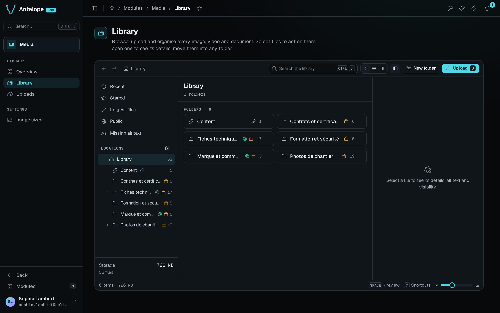

<div align="center">

# `@antelopejs/dms-media`

<a href="https://www.npmjs.com/package/@antelopejs/dms-media"></a>
<a href="./LICENSE"></a>
<a href="https://discord.gg/g4pFt6eXqu"></a>
<a href="https://dms.antelopejs.com/docs/modules/media"></a>

A media library for the AntelopeJS DMS: uploads, folders, image sizes and light editing.

</div>



## What it does

- Organises images, videos and documents in a Finder-style explorer, with smart views, search, drag and drop and bulk actions.
- Uploads files straight to the project's file storage and delivers them from stable `/media/<id>/<name>` URLs.
- Renders named image sizes on first request, with crop and rotation that can revert to the original.
- Applies per-folder rights built on the DMS permissions and roles.
- Adds an `AssetType` form field, from [`@antelopejs/interface-dms-media`](https://github.com/AntelopeJS/dms-media/tree/main/packages/interface-dms-media), that opens the library as a picker on your pages.
- Lets a project ship folders and files as code with `EnsureMediaFolder` and `ImportMediaAsset`, created once and never overwriting what members changed.

## Install

Run the AntelopeJS CLI from the root of a project that already loads `@antelopejs/dms` and a file storage module:

```bash
ajs project modules add @antelopejs/dms-media
```

## Quick start

Point the module's links at the API's public URL, and allow the dashboard's origin, since the browser uploads straight to the storage:

```ts fragment
// antelope.config.ts
"dms-media": {
  source: { type: "package", package: "@antelopejs/dms-media", version: "^0.8.0" },
  config: {
    publicBaseUrl: "${@api.API_PUBLIC_BASE_URL}",
  },
},
api: {
  config: {
    cors: { allowedOrigins: ["https://dms.example.com"] },
  },
},
```

Restart the backend, then the frontend, and open **Modules › Media** (`/modules/media/overview`). To let members pick files from your own pages, add an asset field:

```ts fragment
import { AssetType } from "@antelopejs/interface-dms-media";

new AssetType({
  mimetypes: ["image/*"],
  binding: { id: "articles.cover", folderName: "Article covers", permissionsFromPage: ArticlesPage },
});
```

## Compatibility

<!-- antelopejs-docs-compat:start -->

| Package                                     | Supported          | Tested with |
| ------------------------------------------- | ------------------ | ----------- |
| `@antelopejs/interface-api`                 | `>=0.3.3 <0.4.0`   | `0.3.3`     |
| `@antelopejs/interface-api-util`            | `>=0.3.2 <0.4.0`   | `0.3.2`     |
| `@antelopejs/interface-core`                | `>=0.5.1 <0.6.0`   | `0.5.1`     |
| `@antelopejs/interface-database`            | `>=0.4.0 <0.5.0`   | `0.4.0`     |
| `@antelopejs/interface-database-decorators` | `>=0.5.2 <0.6.0`   | `0.5.2`     |
| `@antelopejs/interface-dms`                 | `>=0.14.0 <0.15.0` | `0.14.0`    |
| `@antelopejs/interface-dms-media`           | `>=0.4.0 <0.5.0`   | `0.4.0`     |
| `@antelopejs/interface-file-storage`        | `>=0.1.8 <0.2.0`   | `0.1.8`     |

<!-- antelopejs-docs-compat:end -->

The module also needs a DMS backend in a release that implements the `@antelopejs/interface-dms` range in the table above, and the `@antelopejs/dms-frontend` renderer in the range its frontend module declares in `engines["@antelopejs/dms-frontend"]` of `frontend-vue/package.json`. The `ajs dms` CLI refuses to build it with a renderer outside that range.

- File storage: an `@antelopejs/interface-file-storage` implementation, such as `@antelopejs/file-storage-local`.

## Documentation

- [Introduction](https://dms.antelopejs.com/docs/modules/media/introduction)
- [Installation](https://dms.antelopejs.com/docs/modules/media/installation)
- [Configuration](https://dms.antelopejs.com/docs/modules/media/configuration)
- [Usage](https://dms.antelopejs.com/docs/modules/media/usage/overview)
- [Extending](https://dms.antelopejs.com/docs/modules/media/extending)
- [FAQ](https://dms.antelopejs.com/docs/modules/media/faq)

The guide's sources live in [`packages/dms-media/docs`](https://github.com/AntelopeJS/dms-media/tree/main/packages/dms-media/docs). The module ships the `dms-media` Claude Code skill in [`packages/dms-media/skills`](https://github.com/AntelopeJS/dms-media/tree/main/packages/dms-media/skills), declared under `antelopeJs.skills`.

## Contributing

This package lives in the [`AntelopeJS/dms-media`](https://github.com/AntelopeJS/dms-media) pnpm workspace, next to `@antelopejs/interface-dms-media`. Read [CONTRIBUTING.md](https://github.com/AntelopeJS/dms-media/blob/main/CONTRIBUTING.md) and the [repository README](https://github.com/AntelopeJS/dms-media#contributing) for the development commands.

## License

[Apache-2.0](./LICENSE)
