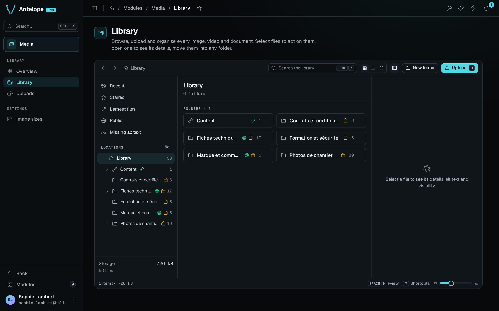
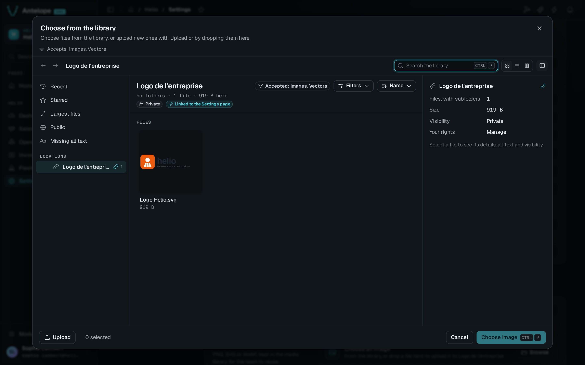

`@antelopejs/dms-media` gives your DMS a media library. Owners organise images, videos and documents in a Finder-style explorer. Your pages reference those files through an `AssetType` form field, which opens the same explorer as a picker. The browser uploads files straight to the storage, the module delivers them from stable URLs, and it renders named image sizes on demand.

## One image from upload to delivery

After [installation](/docs/modules/media/installation), an owner opens **Library**, picks a folder and uploads an image. The file page of that image has an **Alt text** field and a **Delivery** tab with the link to copy. That link, `/media/<id>/<name>`, names the asset. When a browser follows it, the module answers with a redirect to a short-lived signed URL of the storage for most file types, so the signed URL is never the link you share. The module streams SVG and XML files itself.

A new folder is private, and a new file takes the visibility of its folder. A signed-in member with read access to its folder can open the link, and an anonymous request gets no file. Only the owner can make a file or a folder public, for example for a public website image. Members who need to choose images do it through an [asset field](/docs/modules/media/extending#add-an-asset-field) on your pages, without access to the owner-only Media pages.

## What it brings

::card-group
  ::card{title="Finder-style explorer" icon="i-lucide-folder-tree"}
  Folders, smart views, facets, accent-insensitive search, drag and drop, bulk actions, zip downloads and keyboard shortcuts.
  ::

  ::card{title="Per-folder permissions" icon="i-lucide-shield-check"}
  Folder rights reuse the DMS permissions and roles. A field's folder inherits the rights of the page that holds it.
  ::

  ::card{title="Stable delivery" icon="i-lucide-link"}
  A `/media/<id>/<name>` link keeps working through edits, renames and visibility changes. A link with an old file name redirects to the current one.
  ::

  ::card{title="Image sizes and editing" icon="i-lucide-crop"}
  sharp renders each named size on its first request. Crop and rotation keep the original upload, so you can revert to it.
  ::
::

## How members use it

The Media pages are the owner's administration of the library. Like every DMS module page, they are owner-only. Members reach media through your pages instead. An `AssetType` field on a project page opens the picker on a folder defined in advance, with the rights of that page.

## Where it lives in the dashboard

| Group | Page | Path |
| --- | --- | --- |
| Library | [Overview](/docs/modules/media/usage/overview) | `/modules/media/overview` |
| Library | [Library](/docs/modules/media/usage/library) | `/modules/media/files` |
| Library | [Uploads](/docs/modules/media/usage/uploads) | `/modules/media/uploads` |
| (hidden) | [File](/docs/modules/media/usage/file) and [Edit image](/docs/modules/media/usage/image-editor) | `/modules/media/file?asset=`, `/modules/media/editor?asset=` |
| (hidden) | [Activity](/docs/modules/media/usage/overview#activity) | `/modules/media/activity` |
| Settings | [Image sizes](/docs/modules/media/usage/image-sizes) | `/modules/media/presets` |

::card-group
  ::card{title="Installation" icon="i-lucide-download" to="/docs/modules/media/installation"}
  Add the module and allow the dashboard's origin on the storage.
  ::

  ::card{title="Add an asset field" icon="i-lucide-image-plus" to="/docs/modules/media/extending"}
  Reference library files from your forms.
  ::
::
