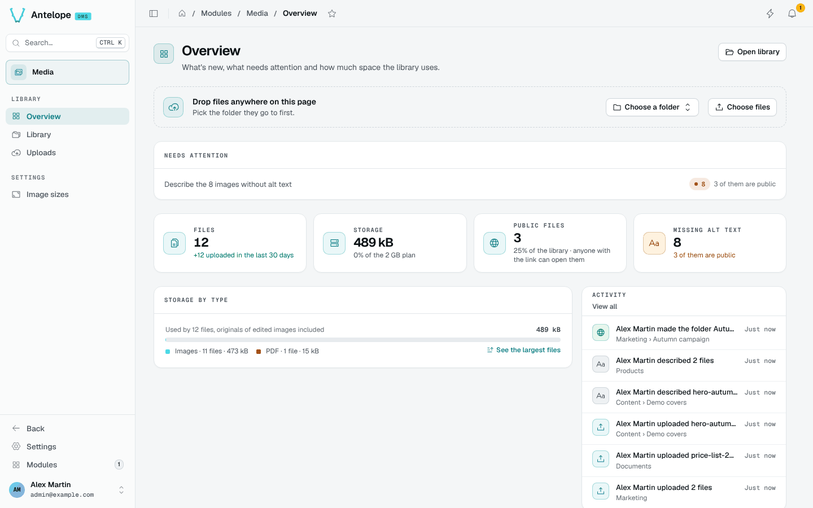
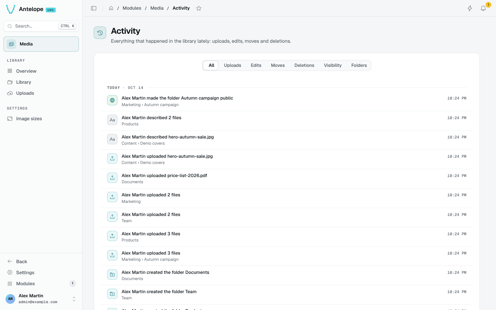

The Overview is the module's landing page, at `/modules/media/overview`. Like every DMS module page, it is reserved to the platform owner. Its **Open library** button opens the [Library](/docs/modules/media/usage/library).

The page holds these blocks, from top to bottom:

- **Toolbar** shows when the page last read the library and switches between **Direct** and **Pause**. See [Live updates](#live-updates).
- **Start your media library** shows only while the library is empty. It offers to create four starter folders (Catalog, Marketing, Brand and Documents) in one click.
- **Drop zone** takes files dropped anywhere on the page, or picked with **Choose files**. They go to the last folder you used, which the browser remembers. The first time, you pick the folder before you drop.
- **Needs attention** lists what to fix first. It counts the images without alt text and how many of them are public, the uploads that failed in the last 24 hours, and the files over 20 MB.
- **KPIs** show the files and how many were added in the last 30 days, the storage used, against the plan that `storageQuotaBytes` sets when it is set, the public files, and the images missing alt text.
- **Storage by type** shows the space each kind of file uses, originals of edited images included. **See the largest files** opens the Largest files view of the library.
- **Activity** lists the six latest events of the library, such as uploads, edits, moves and visibility changes. **View all** opens the [Activity](#activity) page.
- **Recently added** shows the newest files of the library.

## Live updates

The Overview, [Uploads](/docs/modules/media/usage/uploads) and [Activity](#activity) pages follow the library as it changes. An upload, an edit or a move elsewhere updates their figures, lists and feeds. Each block reads the library again when it changes, at most once every two seconds. Each of these pages opens on the DMS page toolbar, the first block under the page header. The toolbar shows how long ago the page last read the library and switches between **Direct** and **Pause**. The `L` key switches too.

Every block that shows the library follows it:

- On the Overview, the KPIs, needs attention, storage by type, activity and recently added files.
- On Activity, each filter of the feed.
- On Uploads, the recent batches.

While the page is paused, none of these blocks reads. The toolbar counts the changes the page missed ("12 changes", one per activity entry), and **Direct** reads them again at once. The uploads in progress keep moving while the page is paused, because they are your own uploads and not changes from elsewhere.

The three pages share one **Direct** or **Pause** choice, and the browser keeps it. `?live=0` in the URL opens a page paused. The toolbar has no period selector, because the library's figures are a snapshot and not a window of time.

The toolbar is a block of its own (**Toolbar** in the Roles editor), so a role can hide it.

## Activity

The Activity page (`/modules/media/activity`) lists every write in the library, grouped by day. It shows the latest 50 events. Its tabs filter the feed by kind: **All**, **Uploads**, **Edits**, **Moves**, **Deletions**, **Visibility** and **Folders**. The page is hidden from the sidebar and opens from **View all** on the Overview.

A nightly clean-up deletes the events older than 90 days. The same events feed the Overview, the **History** tab of each [file](/docs/modules/media/usage/file) and the upload batches of the [Uploads](/docs/modules/media/usage/uploads) page.

The page is live. New events show up as they happen, and **Pause** freezes the feed while you read it.
