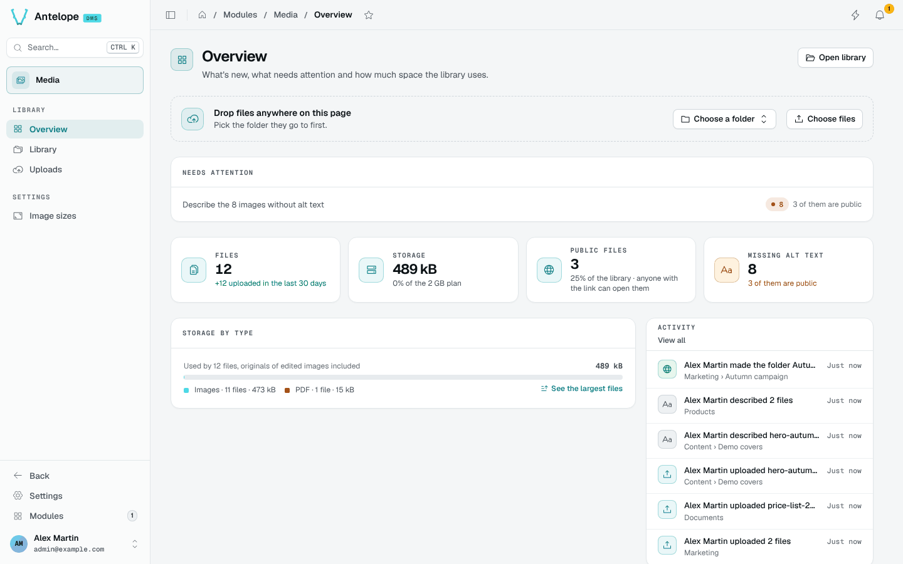

# Overview

The Overview is the module's landing page, at `/modules/media/overview`. It is reserved to the platform owner.

- **Toolbar**: when the page last read the library, and **Direct** / **Pause** (see [Live updates](#live-updates)).
- **Drop zone**: drop files anywhere on the page, or **Choose files**, after picking the folder they go to.
- **Needs attention**: what to fix first, such as images without alt text, and how many of them are public.
- **KPIs**: files (and uploads in the last 30 days), storage against the plan set by `storageQuotaBytes`, public files, and images missing alt text.
- **Storage by type**: the space each kind of file uses, originals of edited images included, with a link to the largest files.
- **Activity**: the latest uploads, edits, moves and visibility changes. **View all** opens the [Activity](/docs/modules/media/usage/activity) page.

## Live updates

The Overview, [Uploads](/docs/modules/media/usage/uploads) and [Activity](/docs/modules/media/usage/activity) pages follow the library as it changes: an upload, an edit or a move elsewhere updates their figures, lists and feeds within two seconds. Each one opens on the DMS page toolbar, the first block under the page header, which shows how long ago the page last read the library and switches between **Direct** and **Pause** (or press `L`).

Every block that shows the library follows it: on the Overview the KPIs, needs attention, storage by type, activity and recent files; on Activity each filter of the feed; on Uploads the recent batches. Paused, none of them reads, the page counts the changes it missed ("12 changes", one per entry of the activity) and **Direct** reads them again at once. The uploads in progress keep moving while paused: they are your own, not news from the library.

The Direct / Pause choice is shared by the three pages and kept in the browser, and `?live=0` opens a page paused. The toolbar has no period: the library's figures are a snapshot, not a window of time.

The toolbar is a block of its own (**Toolbar** in the Roles editor), so a role can hide it.
