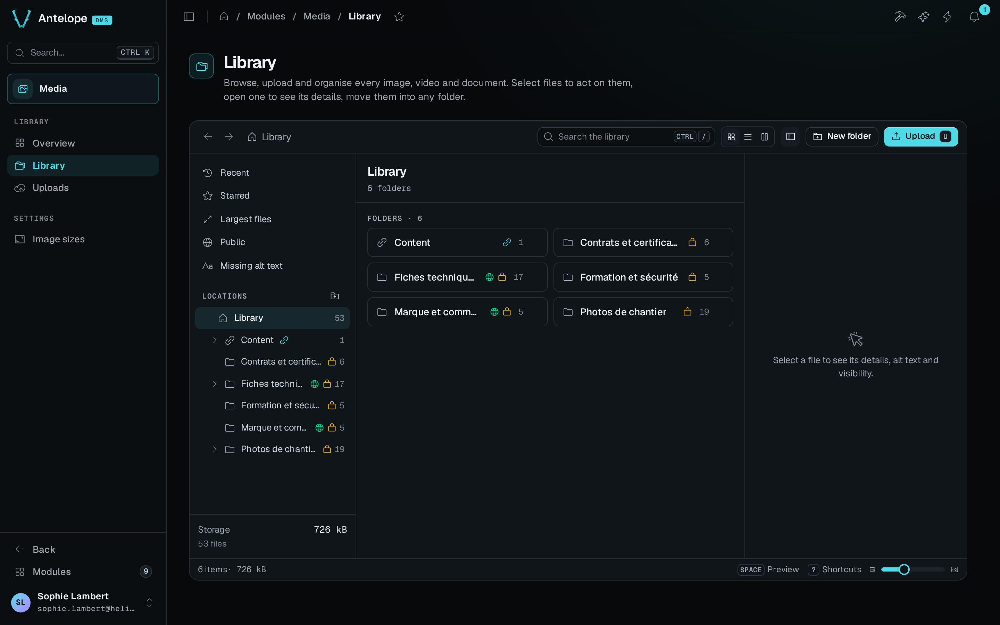
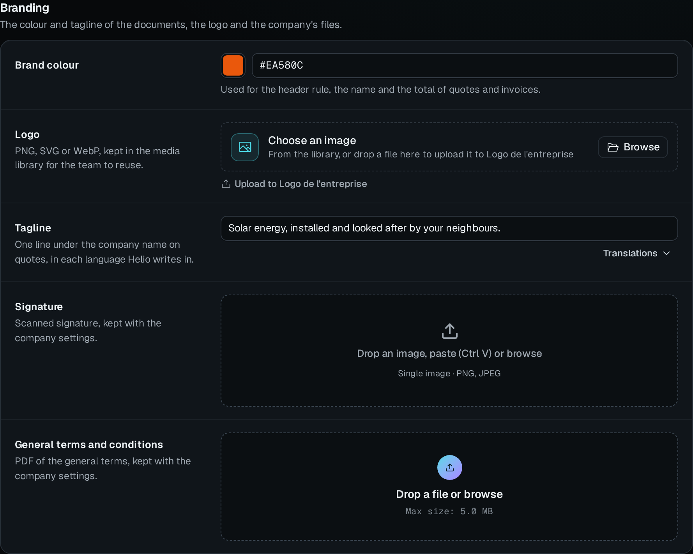
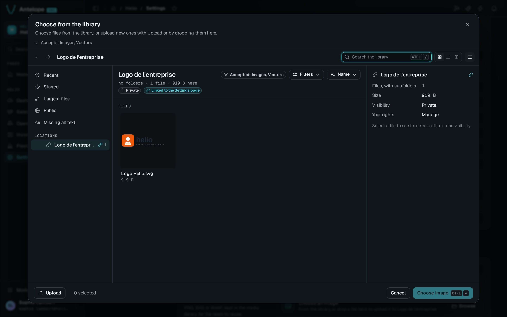

The Library page (`/modules/media/files`) is a Finder-style explorer of every folder and file. The same explorer opens as the picker of an [asset field](#asset-field).

## Navigate

- **Views** are Recent, Starred, Largest files, Public and Missing alt text. A view or a search can stay inside one folder and its subfolders.
- **Locations** is the folder tree. A linked folder, which feeds a field of one of your pages, shows a link icon. A starred folder shows a star.
- **Search** looks in file names, alt text and folder names, and ignores accents, case and punctuation. Every word of the search must appear in the file's name, its alt text or its folder path, in any order, and at least one word must appear in the name or the alt text.
- **Filters** narrow the files by type, visibility, modification date and orientation. The sort order is Name, Date added, Size or Type.
- **Display** is a grid, a list or columns, with a slider for the thumbnail size. The details panel shows the selected file. When the explorer is at least 1000px wide, the panel sits beside the files. When it is narrower, the panel opens in the DMS drawer from the right, headed by the file's name and its place among the files shown. Its previous and next buttons, and the `J` and `K` keys, step through the files.
- **Thumbnails** use the `thumb` image size, cropped square. SVG files use the uncropped `preview` size and fit inside the tile, so a wide logo shows whole. Other files, PDFs included, show an icon of their type.

## Act on files

- **Upload**, or a drop on the explorer, sends files to the current folder through the shared upload queue, which keeps going while you navigate.
- **New folder** creates a subfolder. Names are unique in a folder, whatever their case. An upload whose name is already taken offers **Keep both**, which adds a number (`photo (2).jpg`), or **Cancel**, which leaves that file out.
- A selection of files can be moved, starred, made public or private, deleted, or downloaded as a zip. A folder downloads as a zip with its subfolders. A zip holds at most 200 files and 1 GiB.
- The details panel edits the alt text, opens the [file page](/docs/modules/media/usage/file) and the [image editor](/docs/modules/media/usage/image-editor), copies the link and downloads the file.

## Keyboard shortcuts

The shortcuts work anywhere in the explorer, except while you type in a field.

| Shortcut | Action |
| --- | --- |
| `⌘ /` or `Ctrl /` | Search |
| `Enter` | Open the details |
| `Space` | Preview |
| `←` `→` | Previous file, next file |
| `Shift ↓` | Extend the selection |
| `⌘ Space` | Tick or untick a file |
| `⌘ ↑` | Open the parent folder |
| `U` | Upload |
| `Shift N` | New folder |
| `E` | Edit image |
| `F2` | Rename |
| `M` | Move |
| `Delete` | Delete |
| `⌘ A` | Select all |
| `Escape` | Clear the selection |
| `1`, `2`, `3` | Grid, list, columns |
| `I` | Details panel |
| `?` | All shortcuts |

::note
A linked folder cannot be renamed, moved or deleted, and its rights come from its binding. It holds subfolders only when its binding allows them, and they accept the same types as the field. A name that Windows or macOS cannot save is refused.
::

## Asset field

Members never open the Media pages. They use the library through an `AssetType` field on your project's pages. The field shows what it accepts, opens the explorer as a picker, and uploads into the folder the field is bound to.

The picker is the library explorer, limited to the folders the member can read. When the field has a linked folder, the picker is limited to that folder and its subfolders. Files of a type the field does not accept show, but the picker refuses them and says which types the field accepts. **Upload**, or a drop on the picker, sends new files to the field's linked folder. A drop on the field itself uploads there too.

[Extending](/docs/modules/media/extending#add-an-asset-field) covers how to declare the field.
