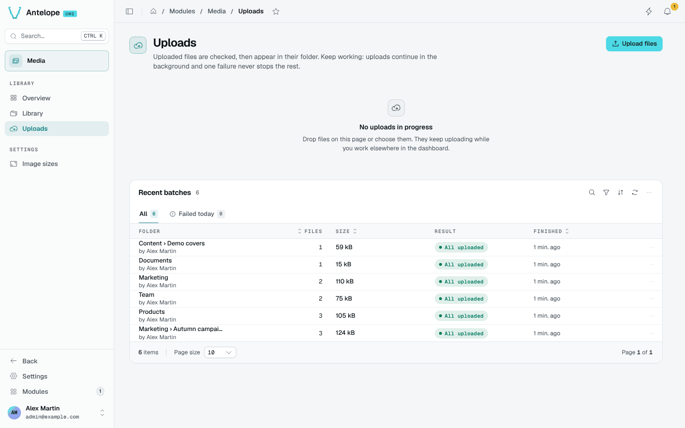

Uploads go straight from the browser to the storage, in three steps. The API checks the type and the quota (`presign`), the browser `PUT`s the bytes to the storage, and the API checks the file again (`confirm`). At `confirm`, the API reads a declared raster image back from the storage and decodes it with sharp. The upload itself never passes through the API server.

The page (`/modules/media/uploads`) shows the uploads in progress, which continue in the background while you work elsewhere in the dashboard. The **Upload files** button in the page header opens the file picker. Below the queue, **Recent batches** lists the folder, the number of files, their size, the result and when they finished. **Open the folder** opens a batch's folder in the library. The **Failed today** tab keeps the batches with a file that failed in the last 24 hours.

The page is [live](/docs/modules/media/usage/overview#live-updates), so a batch finished in another tab shows up on its own. While the page is paused, **Recent batches** keeps its rows, through search, sorting and paging too. A banner counts what is new, and **Show** reads the rows once without leaving the pause.

A refused file never stops the rest of its batch. The queue explains each refusal in plain words: a type that the library or the field does not accept, a full storage plan, an image that does not decode, or a storage that refuses the dashboard's origin. [Upload refusals](/docs/modules/media/configuration#upload-refusals) lists them.
