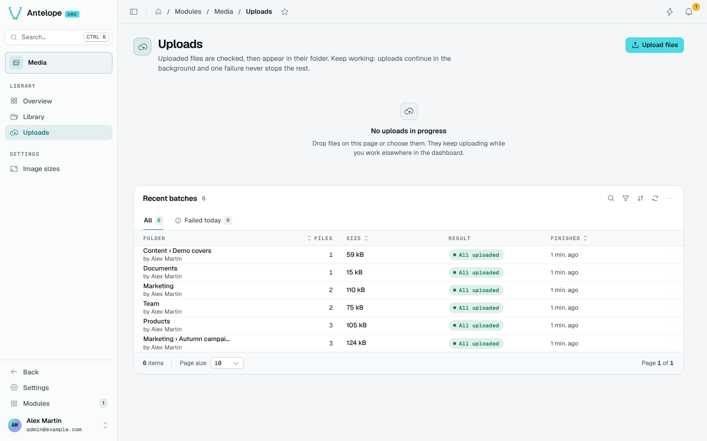

# Uploads

Uploads go straight from the browser to the storage: the API checks the type and the quota (`presign`), the browser `PUT`s the bytes, and the API checks the file again (`confirm`), decoding declared images with sharp. The bytes never transit through Node.

The page (`/modules/media/uploads`) shows the uploads in progress, which continue in the background while you work elsewhere in the dashboard, and the **Recent batches**: the folder, the number of files, their size, the result and when they finished. The **Failed today** tab keeps the batches with a refused file.

The page is [live](/docs/modules/media/usage/overview#live-updates): a batch finished in another tab shows up on its own. Paused, the **Recent batches** keep their rows, through search, sorting and paging too, and a banner counts what is new, with **Show** to read the rows once without leaving the pause.

A refused file never stops the rest of its batch. The queue explains each refusal in plain words: a type the library or the field does not accept, a full storage plan, an image that does not decode, or a storage that refuses the dashboard's origin. See [Upload refusals](/docs/modules/media/configuration#upload-refusals).
