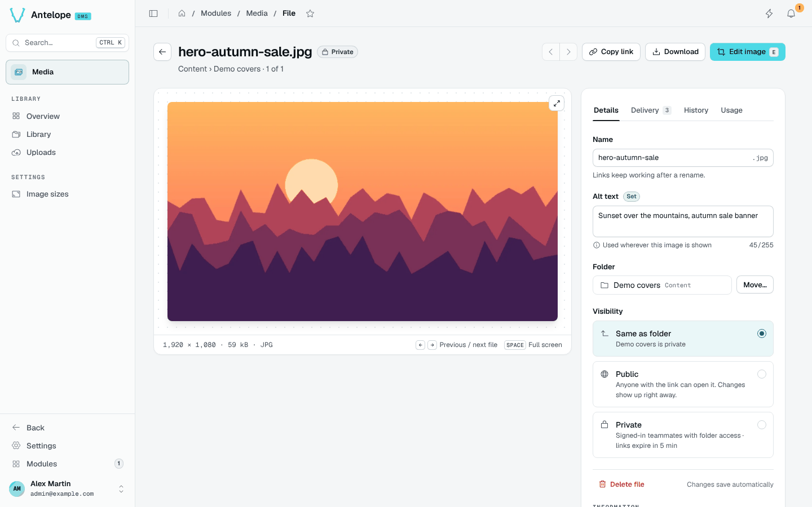

# File

Each file has a page at `/modules/media/file?asset=<id>`, opened from the library or from a private link a signed-out browser followed.

## Header

**Copy link**, **Download** and, for images, **Edit image** (`E`). The arrows move to the previous and next file of the folder.

## Tabs

- **Details**: the name (links keep working after a rename), the alt text, the folder with **Move…**, and the visibility: same as the folder, public (anyone with the link) or private (signed-in teammates with folder access; links expire after 5 minutes).
- **Delivery**: the stable link of the original and of each [image size](/docs/modules/media/usage/image-sizes), starting with `publicBaseUrl`.
- **History**: every event of the file, from its upload on.
- **Usage**: not tracked yet. The tab reminds you to check the pages and e-mails that embed the file before you delete it or make it private.

::note
Changing a file's visibility is reserved to the owner. Members who can write in a linked folder can upload, describe, rename, move, delete and edit its files.
::
