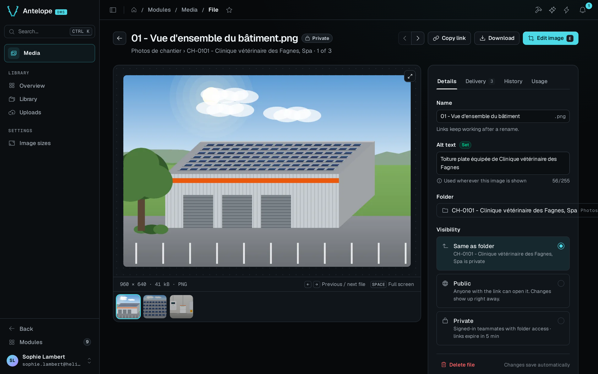

Each file has a page at `/modules/media/file?asset=<id>`. It opens from the library, or from a private link that a signed-out browser followed. Without `?asset=`, the page sends you to the library.

## Header

The header holds **Copy link**, **Download** and, for images, **Edit image** (`E`). Its arrows, and the `←` and `→` keys, open the previous and next file of the folder.

## Tabs

- **Details** shows the name, the alt text, the folder with **Move…**, and the visibility. Links keep working after a rename. The visibility is one of three choices. **Same as folder** follows the folder. **Public** opens for anyone with the link. **Private** opens only for signed-in teammates with access to the folder, through links that expire after 5 minutes.
- **Delivery** shows the stable link of the original and of each [image size](/docs/modules/media/usage/image-sizes). The links start with `publicBaseUrl`, or with the DMS `apiBaseUrl` when `publicBaseUrl` is not set.
- **History** lists every event of the file, from its upload on.
- **Usage** is not tracked yet. The tab says to check the pages and emails that embed the file before you delete it or make it private.

::note
Only the owner changes a file's visibility, and only the owner moves a file to a folder where its visibility would change. Members who can write in a linked folder can upload, describe, rename, move, delete and edit its files.
::
