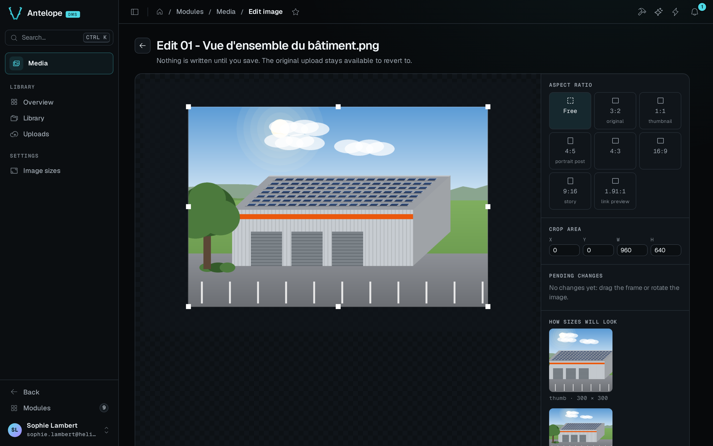

The editor (`/modules/media/editor?asset=<id>`) crops and rotates an image on the server. It edits JPEG, PNG, WebP and AVIF images. An SVG file is a vector drawing and is edited in a design tool instead. Nothing is written until you save.

- **Aspect ratio** is free, the original ratio, or a preset: 1:1 thumbnail, 4:5 portrait post, 4:3, 16:9, 9:16 story and 1.91:1 link preview.
- **Crop area** is a frame you drag, or whose position and size you type. The arrow keys move the frame, and `Shift` with an arrow key resizes it.
- **Rotation** turns the image left or right in 90° steps.
- **How sizes will look** shows the result in each configured [image size](/docs/modules/media/usage/image-sizes).

**Save** overwrites the image everywhere it is used, and every image size is rendered again the next time it is requested. **Save as copy** writes the edit as a new file in the same folder and leaves the source untouched. The first save keeps the original upload, and its size counts in the storage. Every later edit renders from that original, and **Revert to original** restores it.

::note
An `AssetType` field has no crop button, because editing an image changes it everywhere it is used.
::
