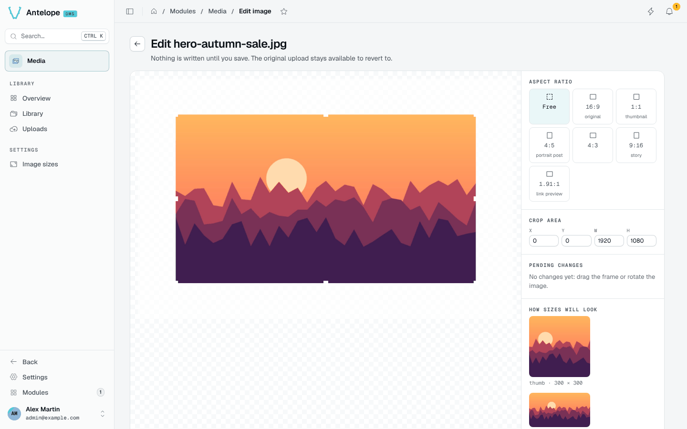

# Image editor

The editor (`/modules/media/editor?asset=<id>`) crops and rotates an image on the server. Nothing is written until you save.

- **Aspect ratio**: free, the original ratio, or presets such as 1:1 thumbnail, 4:5 portrait post, 9:16 story and 1.91:1 link preview.
- **Crop area**: drag the frame or type its position and size.
- **Rotation**: 90° steps.
- **How sizes will look**: the result in each configured [image size](/docs/modules/media/usage/image-sizes).

**Save** overwrites the image everywhere it is used and invalidates its sizes. **Save as copy** writes the edit as a new file next to the untouched source. The pristine original is kept on the first edit (its size counts in the storage), every later edit renders from it, and **Revert** restores it.

::note
An `AssetType` field has no crop button: editing an image changes it everywhere it is used.
::
