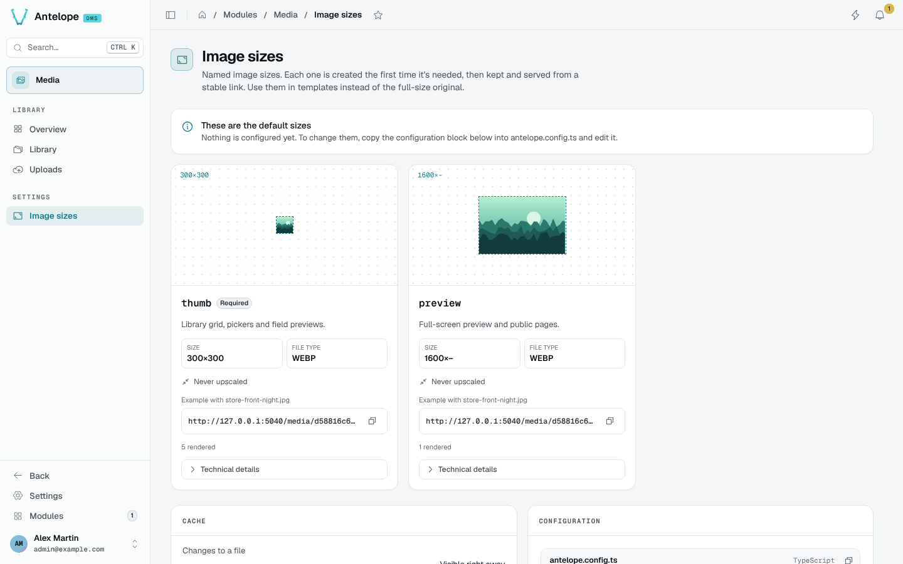

# Image sizes

**Settings › Image sizes** (`/modules/media/presets`) shows the configured presets. Each size is rendered by sharp the first time it is asked for, then cached in the storage and served from a stable link: use sizes in your templates instead of the full-size original.



Each card shows the size, the format, an example link built on one of your images, and how many renderings are cached. The example link starts with `publicBaseUrl`, ready to copy; the preview above it loads through the dashboard's own origin, so it shows even when the example image is private. The **Configuration** card gives the `antelope.config.ts` block to copy when you want to change them. See [Image size presets](/docs/modules/media/configuration#image-size-presets).

```text
GET /media/<assetId>/<presetId>/<filename>
```

An image sharp cannot read answers `422`; a size that fails to render for another reason answers `503`.
