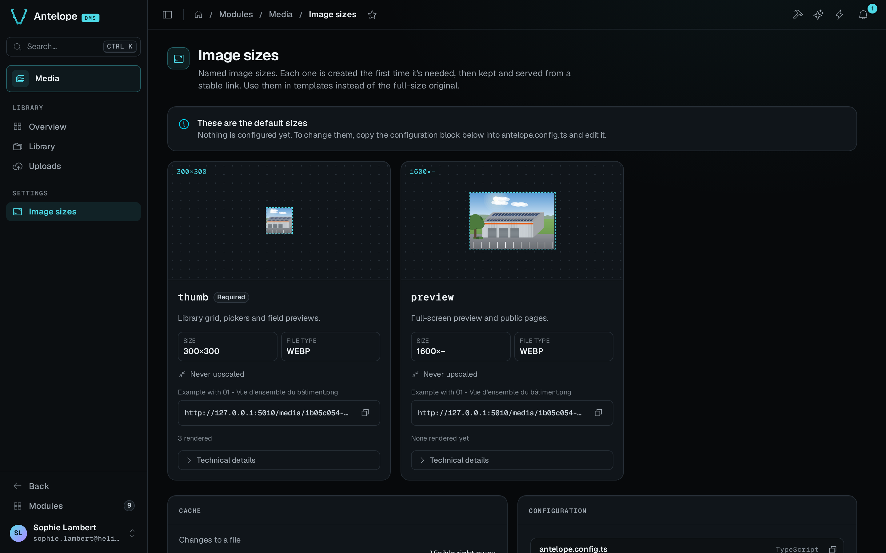

**Settings › Image sizes** (`/modules/media/presets`) shows the configured image sizes. sharp renders each size the first time it is requested. The storage then keeps the rendering, and a stable link serves it. A size is lighter to serve than the full-size original, which is why templates use sizes.



Each card shows the size, the format, an example link built on one of your images, and how many renderings are cached. The example link starts with `publicBaseUrl`, or with the DMS `apiBaseUrl` when `publicBaseUrl` is not set, ready to copy. The preview above it loads through the dashboard's own origin, so it shows even when the example image is private.

The **Cache** card shows how long the signed links of public and private files stay valid, and when the nightly clean-up of old sizes last ran and runs next. An edit, a replacement or a switch to private shows on the next request.

The **Configuration** card gives the `antelope.config.ts` block that declares the sizes. A size changed there serves the new version from its existing links, with no cache to clear. [Image size presets](/docs/modules/media/configuration#image-size-presets) describes the configuration.

```text
GET /media/<assetId>/<presetId>/<filename>
```

An unknown size, or a size of a file that is not an image, answers `404`. An image that sharp cannot read answers `422`. A size that fails to render for another reason answers `503`.
