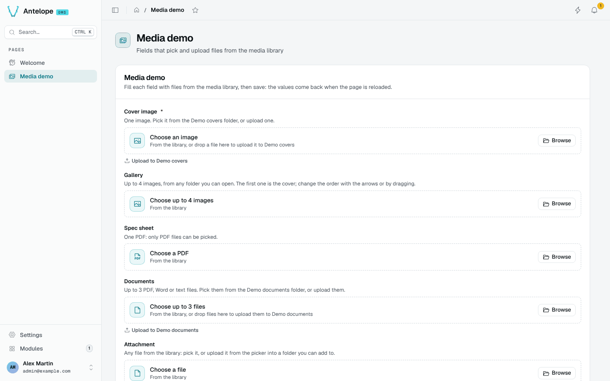

# Asset field

Members never open the Media pages: they use the library through an `AssetType` field on your project's pages. The field shows what it accepts, opens the explorer as a picker, and uploads into the folder the field is bound to.

The picker is the library explorer, limited to the folders the member can read and to the types the field accepts. **Upload** or a drop sends new files to the field's linked folder.

Declaring the field is covered in [Extending](/docs/modules/media/extending#add-an-asset-field).
