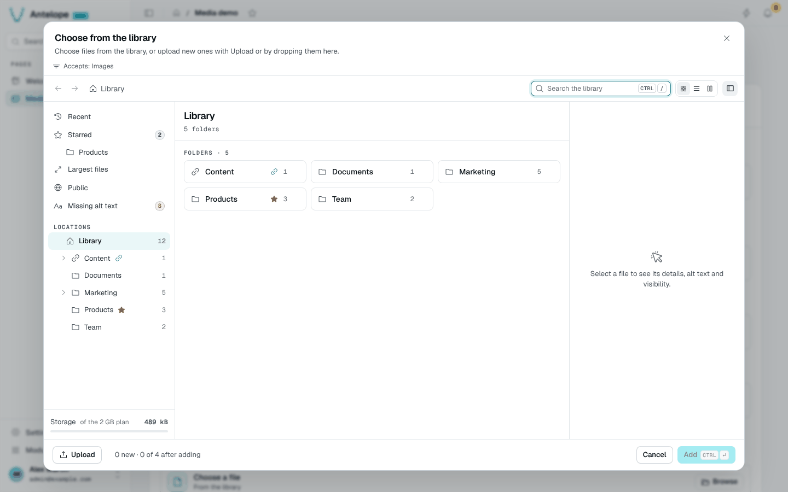

# Extending

Other modules use the library through the separately published `@antelopejs/interface-dms-media` interface, which this module implements. It exports the `AssetType` form field, `RegisterAssetBinding` / `UnregisterAssetBinding`, `EnsureMediaFolder` / `ImportMediaAsset` to ship content as code, `RetireMediaDeclaration` / `PruneMediaDeclarations` to take it back, and the ACL types.

## Add an asset field

`AssetType` and the folder bindings it declares live in the interface package `@antelopejs/interface-dms-media`, which this module implements. Declare the interface in the consumer module's `dependencies` and import from it:

```bash [Terminal]
pnpm add @antelopejs/interface-dms-media
```

```typescript [src/articles.ts]
import { AssetType } from "@antelopejs/interface-dms-media";

new AssetType({
  multiple: true,
  max: 4,
  mimetypes: ["image/*"],
  binding: {
    id: "articles.cover",
    folderName: "Article covers",
    permissionMapping: {
      read: ["articles.page"],
      write: ["articles.page.table.edit", "articles.page.table.add"],
    },
  },
});
```

For a field on a DMS page, pass `permissionsFromPage: ArticlesPage` to derive
the folder mapping from that page rather than copying its permission ID.
The [consumer reference](/docs/modules/media/reference) defines field options,
validation, binding lifecycle and ACL precedence, including the meaning of an
explicit empty mapping.

The form stores up to four asset IDs, for example `['asset-a', 'asset-b']`, not
file bytes or delivery URLs. The picker below shows the corresponding image
restriction and four-item limit before any file is selected.



::tip
Keep your page backend-declared: the `AssetType` field goes in a DMS `Form` block, and the page needs no custom Vue.
::

## Ship folders and files as code

A project that ships media content (document templates, procedures, demo pictures) declares it from its backend with `EnsureMediaFolder` and `ImportMediaAsset`, rather than through the owner's HTTP routes or the module's tables. The module validates each declaration with the dashboard's rules, writes the bytes to its own file storage, computes image dimensions and records the creation in the activity, attributed to `System`.

```typescript [src/media-content.ts]
import path from "node:path";
import { EnsureMediaFolder, ImportMediaAsset } from "@antelopejs/interface-dms-media";

const CONTENT_DIR = path.join(__dirname, "../content");

export async function declareMedia(tenantId: string): Promise<void> {
  await EnsureMediaFolder({ tenantId, key: "helio.procedures", name: "Procedures" });
  await ImportMediaAsset({
    tenantId,
    key: "helio.procedures.roof",
    folder: { key: "helio.procedures" },
    name: "Roof safety checklist.pdf",
    mimetype: "application/pdf",
    source: { filePath: path.join(CONTENT_DIR, "roof-safety-checklist.pdf") },
  });
  // Into the folder of an asset field: its binding id.
  await ImportMediaAsset({
    tenantId,
    key: "helio.projects.cover.demo",
    folder: { binding: "projects.cover" },
    name: "Array on a barn roof.jpg",
    mimetype: "image/jpeg",
    alt: "Solar array on a barn roof",
    source: { filePath: path.join(CONTENT_DIR, "barn-roof.jpg") },
  });
}
```

- Every call requires an explicit `tenantId` and is keyed by tenant, kind and `key`. Omitted, empty and whitespace-only tenant ids reject before writes; there is no fallback. Passing `DEFAULT_TENANT_ID` explicitly is valid for intentional single-tenant content. Existing callers of these new APIs must add their tenant id; older APIs are unchanged.
- They never undo a member's work. A folder or file renamed, moved, re-shared, edited or deleted in the library since it was last declared is left as is; one still exactly as declared is refreshed when the declaration changes. The result's `status` says which happened: `created`, `updated`, `unchanged`, `preserved` or `deleted`. The [consumer reference](/docs/modules/media/reference#the-refresh-rule) gives the exact rule.
- Generated content does not need regenerating on every boot: pass `source: { load }`, which the module calls only when it needs the bytes, and a `version` you change whenever they change (a hash of the generator's inputs, for example). While `version` matches the key's last declaration, the source is not read at all; files a member changed or deleted are never read either.

  ```typescript
  await ImportMediaAsset({
    tenantId,
    key: "helio.reports.sample",
    folder: { key: "helio.procedures" },
    name: "Sample report.png",
    mimetype: "image/png",
    version: REPORT_TEMPLATE_VERSION,
    source: { load: () => renderSampleReport() },
  });
  ```

- Content the code stops declaring is not deleted by itself. `PruneMediaDeclarations({ tenantId, prefix, keep })`, called after the current declarations with the keys they used, retires every other key of the namespace: files first, then folders from the deepest, each removed only while still exactly as declared (and, for a folder, empty). Changed, filled or deleted content is left alone and handed over to the members. `RetireMediaDeclaration({ tenantId, kind, key })` does the same for one key.

  ```typescript
  // After declareMedia(tenantId): the keys this version declared.
  const keys = ["helio.procedures", "helio.procedures.roof", "helio.projects.cover.demo"];
  await PruneMediaDeclarations({ tenantId, prefix: "helio.", keep: keys });
  ```

- Calls wait for module/database readiness, not SaaS provisioning completion. Do not await them in `construct()`.
- `interface-file-storage` has no server-side write, so the module writes through a presigned URL from the backend. With `file-storage-local` that URL is on the API server: a call made before the server listens waits for it, up to two minutes.

The application passes a trusted tenant into this routine. Required `tenantId` does not prove authorization or provisioning completion: the functions use existing tables without inferring a session or creating a workspace. `start()` is process-global; reserve it for registration or explicitly scoped global work, not implicit default-tenant creation.

For new SaaS tenants, register an application-owned `RegisterWorkspaceLifecycleConsumer` from `@antelopejs/interface-dms-saas/workspace-lifecycle` for `created`, before startup reconciliation. This durable, at-least-once transition follows preparation/payment; deduplicate `operationId` and durably link resources before returning a receipt. Media does not register a consumer or depend on SaaS. The [lifecycle integration skeleton](/docs/modules/media/reference#new-saas-tenants-application-owned-durable-lifecycle) explains persistence, result handling and recovery responsibilities; idempotent declarations are not exactly-once effects. The prepayment `TENANT_BEING_PROVISIONED` hook has no automatic replay or compensation and is not this durable transition.

Refreshing existing tenants at deployment is separate: enumerate a trusted inventory, require `IsWorkspaceProvisioningCommitted(tenantId)`, and fail closed on lookup errors. See [refresh and backfill](/docs/modules/media/reference#existing-tenants-deployment-refresh-and-backfill) and the [tenant scope reference](/docs/modules/media/reference#tenant-scope-and-trusted-backend-context). These recommendations leave existing provisioning and hook policy unchanged.

Self-parenting and moves under a descendant reject before changing the hierarchy. A member edit that races a refresh is preserved by a conditional database write, including when file bytes change. The declaration queue is local to the process, so use one declaration writer per tenant and key; see the [refresh rule and limits](/docs/modules/media/reference#the-refresh-rule).

## Access model

The module's pages are the **owner's administration** of the library: like the pages of every DMS module they are owner-only, on purpose, and cannot be given to a role.

Members use media **through the component the module exports**: an `AssetType` field placed on the **project's** pages, which are grantable in Settings › Roles. The field opens the "floating" picker and uploader on a folder defined in advance: its `binding` provisions a linked folder, and `permissionsFromPage` derives that folder's rights from the project page that holds the field. A member whose role grants the page can see the linked folder and upload into it from the picker, without ever opening a Media page:

```typescript
@RegisterPage()
export class ArticlesPage extends PageController("articles", { displayName: "Articles", category: pagesCategory }) {
  static form = Form({
    fields: [
      {
        id: "cover",
        label: "Cover",
        type: new AssetType({
          mimetypes: ["image/*"],
          binding: { id: "articles.cover", folderName: "Article covers", permissionsFromPage: ArticlesPage },
        }),
      },
    ],
  });
}
```

A linked folder holds no subfolders unless its binding sets `subfolders: true`. With it, the field's folder can also be organized per record, such as one folder per project: owners create subfolders in the library, and backend code declares them with `EnsureMediaFolder({ tenantId, key, name, parent: { binding: "projects.photos" } })`. The linked folder itself stays locked; its subfolders inherit its rights unless given their own, and accept only the field's types.

Grant the project page permission explicitly in Settings › Roles, then test the
picker as that member. A page available through `memberAccess` or `publicAccess`
alone is not a folder grant. Review the [folder access contract](/docs/modules/media/reference#permission-precedence-and-tenant-access)
before allowing uploads or opening the root library.

## Permissions

The module registers no permission: nothing about media is offered in Settings › Roles, because the Media pages are owner-only and members reach media through the project's pages (see [Access model](#access-model)).

| Permission | Effect |
|---|---|
| `modules.media.library.files` | Page permission of Library. Like every module page permission it is owner-only: it is not listed in Roles and `HasPermission` refuses it to any non-owner. It grants no folder right |

Operations follow the [folder access contract](/docs/modules/media/reference#permission-precedence-and-tenant-access);
granting a page is not a replacement for the folder's rights.

## Delivery URLs

`GET /media/:assetId/:filename` 302-redirects to a signed storage URL. A link with a stale file name redirects to the canonical one.

### Caching and visibility

The redirect itself is never cached, so an edit or a visibility change shows on the next request:

| Asset visibility | Redirect headers and checks |
| --- | --- |
| Public | `Cache-Control: no-cache` and `Access-Control-Allow-Origin: *`. |
| Private | `Cache-Control: no-store`, after authentication and a folder read check. |

The signed URL the redirect points to is reused for half its lifetime. Visibility (asset override → folder → private) is a flag flip; URLs never change.

### Active content

Active content is the exception to the storage redirect. The API serves SVG inline and HTML, XHTML and XML files as `attachment`, with:

- `Content-Security-Policy: sandbox`.
- `X-Content-Type-Options: nosniff`.
- ETag/304 and Range support.

### Private files without a token

A browser that opens a private file without a token is redirected to the file's page in the dashboard (`/modules/media/file?asset=`), which signs in and comes back. When the dashboard URL is unknown, the browser gets a 401 HTML page.

## HTTP surface

- Library: `GET /api/media/tree` (folders, plus `allowedMimetypes`), `GET /api/media/folders/:id/assets|impact`, `GET /api/media/views/:view` (`recent`, `starred`, `missing-alt`, `largest`, `public`), `GET /api/media/search` (an empty `q` finds nothing), `POST /api/media/favorites`, `POST /api/media/folders/starter`. Folder listings and views take the `type`, `visibility`, `modified` and `orientation` facets; views also take a `folderId` to stay inside one folder
- Overview (owners only, 403 otherwise): `GET /api/media/stats/kpis|storage|attention|recent`, `GET /api/media/activity?type=`
- File: `GET /api/media/assets/:id/details|history|information|delivery|delivery/notice|tab-counts`, `GET /api/media/links/origin` (the origin copied links start with: `publicBaseUrl`, otherwise the DMS `apiBaseUrl`)
- Bulk: `POST /api/media/assets/bulk/move|visibility|delete`, `POST /api/media/assets/zip`, `POST /api/media/folders/:id/zip` (the folder and its subfolders, `read` right)
- Settings: `GET|POST /api/media/upload/batches`, `GET /api/media/presets`, `GET /api/media/presets/config`, `GET /api/media/presets/cache`
- `POST /api/media/folders`, `POST /api/media/folders/:id/rename|move|visibility`, `DELETE /api/media/folders/:id`
- `GET /api/media/assets`, `GET /api/media/assets/search`, `GET /api/media/assets/:id`, `GET /api/media/assets/:id/read-url?preset=`, `POST /api/media/previews`
- `POST /api/media/assets/:id/update|move|visibility|transform|transform/copy|revert`, `DELETE /api/media/assets/:id`
- Upload: `POST /api/media/upload/presign`, `POST /api/media/upload/confirm`, `POST /api/media/upload/abort` (deletes the staged file), `POST /api/media/upload/names` (free names for "Keep both")
- Public delivery: `GET /media/:assetId/:filename`, `GET /media/:assetId/:presetId/:filename`

`GET /api/media/stats/folders` and `GET /api/media/stats/largest` are removed: the overview no longer shows folder cards or the largest files, which the `largest` view lists.

Status codes worth handling:

| Route | Status | Body |
|---|---|---|
| `upload/presign` | 415 | `{ reason: "type_not_allowed", message }`: not in `allowedMimetypes`, or HTML/XHTML/PHP (by type or extension) |
| `upload/presign` | 415 | `{ reason: "field_type", message, accepted }`: the linked folder feeds a field that accepts fewer types |
| `upload/presign` | 413 | `{ reason: "quota", message, remaining, quota }`: the upload would go past `storageQuotaBytes` |
| `upload/confirm` | 422 | `{ reason: "invalid_image", message }`: a declared image that does not decode; the staged file is deleted |
| `assets/:id/update`, `folders`, `folders/:id/rename|move` | 409 | `$dms_media.errors.name_taken` or `folder_name_taken`: the name is taken in that folder, case aside |
| `folders`, `folders/:id/move` | 403 | `$dms_media.errors.bound_parent`: the parent is a linked folder whose binding does not allow subfolders |
| Folder, file and bulk writes | 400 | A `$dms_media.errors.*` key |
| `/media/:assetId/:filename` | 302 | To the signed storage URL (`no-cache` public, `no-store` private), to the canonical file name, or, for a browser without a token on a private file, to the dashboard's File page |
| `/media/:assetId/:filename` | 401 | Private file without a token: bare for scripts, an HTML page for a browser when the dashboard URL is unknown |
| `/media/:assetId/:presetId/:filename` | 422 / 503 | The image cannot be read / the size cannot be rendered right now |
