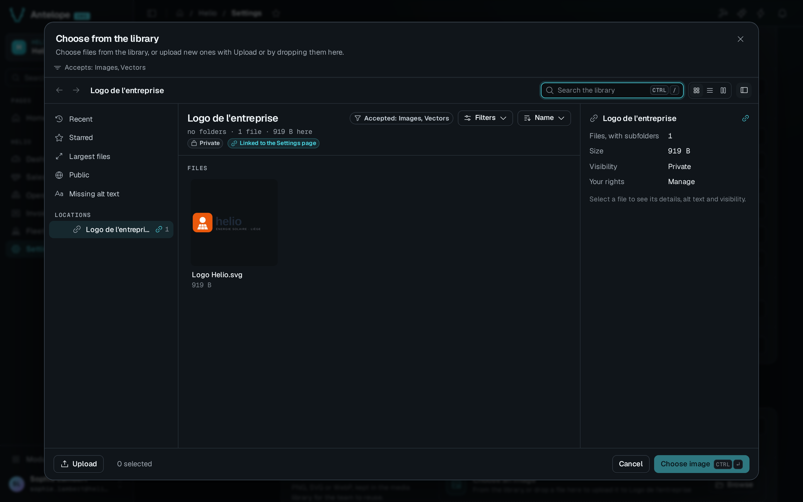

Other modules use the library through the separately published `@antelopejs/interface-dms-media` interface, which this module implements. It exports the `AssetType` form field, `RegisterAssetBinding` and `UnregisterAssetBinding`, `EnsureMediaFolder` and `ImportMediaAsset` to ship content as code when a tenant is provisioned, and the ACL types. The [consumer reference](/docs/modules/media/reference) lists every export.

## Add an asset field

`AssetType` and the folder binding it declares live in `@antelopejs/interface-dms-media`. Add the interface to the consumer module's `dependencies`:

```bash [Terminal]
pnpm add @antelopejs/interface-dms-media
```

Then create the field and give it a `binding`:

```typescript [src/articles.ts]
import { AssetType } from "@antelopejs/interface-dms-media";

new AssetType({
  multiple: true,
  max: 4,
  mimetypes: ["image/*"],
  binding: {
    id: "articles.cover",
    folderName: "Article covers",
    permissionMapping: {
      read: ["articles.page"],
      write: ["articles.page.table.edit", "articles.page.table.add"],
    },
  },
});
```

For a field on a DMS page, pass `permissionsFromPage: ArticlesPage` instead of `permissionMapping`. The folder then takes its rights from that page, and you do not copy its permission ID. The [consumer reference](/docs/modules/media/reference) defines the field options, the validation, the binding lifecycle and the ACL precedence, including what an explicit empty mapping means.

The form stores up to four asset IDs, such as `['asset-a', 'asset-b']`. It never stores file bytes or delivery URLs. The picker below opens from the single-file Logo field of the Helio demo's settings page. It shows the accepted types and the field's linked folder before any file is selected.



::tip
The `AssetType` field goes in a DMS `Form` block, so the page stays declared in the backend and needs no custom Vue component.
::

## Ship folders and files as code

To ship media content with a project, such as document templates, procedures or demo pictures, declare it from the backend with `EnsureMediaFolder` and `ImportMediaAsset`. Do not use the owner's HTTP routes or write the module's tables. The module checks each declaration with the dashboard's rules, writes the bytes to its own file storage, computes the image dimensions and records the creation in the activity, attributed to `System`.

```typescript [src/media-content.ts]
import path from "node:path";
import { Hook, RegisterHook } from "@antelopejs/interface-dms/hooks";
import { EnsureMediaFolder, ImportMediaAsset } from "@antelopejs/interface-dms-media";

const CONTENT_DIR = path.join(__dirname, "../content");

async function declareMedia(tenantId: string): Promise<void> {
  await EnsureMediaFolder({ tenantId, key: "helio.procedures", name: "Procedures" });
  await ImportMediaAsset({
    tenantId,
    key: "helio.procedures.roof",
    folder: { key: "helio.procedures" },
    name: "Roof safety checklist.pdf",
    mimetype: "application/pdf",
    source: { filePath: path.join(CONTENT_DIR, "roof-safety-checklist.pdf") },
  });
  // Into the folder of an asset field: its binding id.
  await ImportMediaAsset({
    tenantId,
    key: "helio.projects.cover.demo",
    folder: { binding: "projects.cover" },
    name: "Array on a barn roof.jpg",
    mimetype: "image/jpeg",
    alt: "Solar array on a barn roof",
    source: { filePath: path.join(CONTENT_DIR, "barn-roof.jpg") },
  });
}

// Registered from construct(): once per tenant, when the tenant is created.
export function registerMedia(): void {
  RegisterHook(Hook.TENANT_BEING_PROVISIONED, async ({ tenantId }) => {
    await declareMedia(tenantId);
  });
}
```

Follow these rules when you write the declarations:

- Pass an explicit `tenantId` to every call. The module keys each declaration by tenant, kind and `key`. An omitted, empty or whitespace-only tenant ID rejects before any write, and there is no fallback. To declare content for a single-tenant install on purpose, pass `DEFAULT_TENANT_ID`.
- Call the functions from a `Hook.TENANT_BEING_PROVISIONED` handler. The DMS fires it once per tenant, when the tenant is created. For the `default` tenant, it fires on the start that creates the tenant, once every `DATABASE_INITIALIZED` handler has finished. For a workspace, the SaaS module fires it when it creates the workspace. Do not call them from `start()` or from a `DATABASE_INITIALIZED` handler, which run on every boot.
- Declare parents before children and folders before files, and await each call.
- Use one declaration writer per tenant and key. The queue that orders the declarations of one key is local to the process.

Declared content is written once. From then on, it belongs to the members. A key declared before returns `kept`, and the module does not read its source again. Nothing is refreshed or taken back. The result's `status` is `created` or `kept`, and its `id` is the library ID of the folder or file. The [consumer reference](/docs/modules/media/reference#written-once) gives the full rule.

The module calls `source: { load }` only when it creates the file. It writes the file from the server through the `WriteFile` function of `interface-file-storage`, with no HTTP round trip.

## Access model

The module's pages are the owner's administration of the library. Like the pages of every DMS module, they are owner-only, and you cannot give them to a role.

Members use media through the component the module exports. That component is an `AssetType` field placed on the project's own pages, which you can grant in **Settings › Roles**. The field opens the picker and the uploader on a folder defined in advance. Its `binding` provisions a linked folder, and `permissionsFromPage` gives that folder the rights of the project page that holds the field. A member whose role grants the page can see the linked folder and upload into it from the picker, without opening a Media page:

```typescript
import {
  PageController,
  RegisterPage,
  pagesCategory,
} from "@antelopejs/interface-dms";
import { Form } from "@antelopejs/interface-dms/base";
import { AssetType } from "@antelopejs/interface-dms-media";

@RegisterPage()
export class ArticlesPage extends PageController("articles", { displayName: "Articles", category: pagesCategory }) {
  static form = Form({
    fields: [
      {
        id: "cover",
        label: "Cover",
        type: new AssetType({
          mimetypes: ["image/*"],
          binding: { id: "articles.cover", folderName: "Article covers", permissionsFromPage: ArticlesPage },
        }),
      },
    ],
  });
}
```

A linked folder holds no subfolders unless its binding sets `subfolders: true`. With that option, you can organize the field's folder per record, such as one folder per project. Owners create the subfolders in the library, and backend code declares them with `EnsureMediaFolder({ tenantId, key, name, parent: { binding: "projects.photos" } })`. The linked folder itself stays locked. Its subfolders inherit its rights unless they have their own, and they accept only the field's types.

To give a member access, grant the project page permission explicitly in **Settings › Roles**, then test the picker as that member. A page that a member reaches only through `memberAccess` or `publicAccess` does not grant any folder right. Read the [folder access contract](/docs/modules/media/reference#permission-precedence-and-tenant-access) before you allow uploads or open the root of the library.

## Permissions

The module offers no permission in **Settings › Roles**. The Media pages are owner-only, and members reach media through the project's pages, as [Access model](#access-model) describes.

| Permission | Effect |
|---|---|
| `modules.media.library.files` | Page permission of the Library page. Like every module page permission, it is owner-only. The Roles editor does not list it, and `HasPermission` refuses it to any member who is not an owner. It grants no folder right. |

Every operation follows the [folder access contract](/docs/modules/media/reference#permission-precedence-and-tenant-access). A page grant does not replace the folder's rights.

## Delivery URLs

`GET /media/:assetId/:filename` answers with a `302` redirect to a signed storage URL. A link with a stale file name redirects to the canonical one.

### Caching and visibility

The redirect itself is never cached, so an edit or a visibility change shows on the next request:

| Asset visibility | Redirect headers and checks |
| --- | --- |
| Public | `Cache-Control: no-cache` and `Access-Control-Allow-Origin: *`. An origin that the API already allows keeps its own CORS answer. |
| Private | `Cache-Control: no-store`, after authentication and a check of the `read` right on the folder. |

The module hands out the same signed URL for half its lifetime. A public file's signed URL lives one hour, and a private file's lives five minutes. A file's visibility is its own setting when it has one, otherwise its folder's, and `private` when neither is set. Changing it does not change any URL.

### Active content

Active content does not redirect to the storage. The API serves the bytes itself. It serves SVG inline, and HTML, XHTML and XML files as `attachment`, with these headers and behaviors:

- `Content-Security-Policy: sandbox`.
- `X-Content-Type-Options: nosniff`.
- `Cache-Control: public, no-cache` for a public file, `private, no-cache` for a private one.
- An `ETag`, with a `304` answer to a matching `If-None-Match`. Byte ranges are not served.
- A `502` when the storage cannot read the file.

### Private files without a token

A browser that opens a private file without a token goes to the file's page in the dashboard (`/modules/media/file?asset=`), which signs the user in and comes back. When the dashboard URL is unknown, the browser gets a `401` HTML page.

## HTTP surface

Every `/api/media` route needs a signed-in tenant member. The routes check folder rights on top of that.

Library routes:

- `GET /api/media/tree` returns the folders, the root rights, the view counts, `allowedMimetypes`, `maxUploadBytes` and `quotaBytes`.
- `GET /api/media/bindings/:bindingId/folder` returns the folder of one field binding, or `null` when the caller cannot see it, with the same upload limits.
- `GET /api/media/folders/:id/assets` and `GET /api/media/folders/:id/impact`.
- `GET /api/media/views/:view`, where `view` is `recent`, `starred`, `missing-alt`, `largest` or `public`.
- `GET /api/media/search`. An empty `q` finds nothing.
- `POST /api/media/favorites`.
- `POST /api/media/folders/starter`, which needs the `manage` right at the root.

Folder listings, views and search take the `type`, `visibility`, `modified` and `orientation` facets, and `offset`, `limit` (up to 500), `sort` and `direction`. Views and search also take a `folderId` to stay inside one folder.

Overview routes answer `403` to anyone but an owner:

- `GET /api/media/stats/kpis`, `GET /api/media/stats/storage`, `GET /api/media/stats/attention` and `GET /api/media/stats/recent`.
- `GET /api/media/activity?type=`, where `type` is `uploads`, `edits`, `moves`, `deletions`, `visibility` or `folders`.

File routes:

- `GET /api/media/assets/:id/details`, `GET /api/media/assets/:id/history`, `GET /api/media/assets/:id/information`, `GET /api/media/assets/:id/delivery`, `GET /api/media/assets/:id/delivery/notice` and `GET /api/media/assets/:id/tab-counts`.
- `GET /api/media/links/origin` returns the origin that copied links start with. It is the module's `publicBaseUrl`, otherwise the DMS `apiBaseUrl`.
- `GET /api/media/assets`, `GET /api/media/assets/search` and `GET /api/media/assets/:id`.
- `GET /api/media/assets/:id/read-url?preset=` returns a signed URL that lives five minutes.
- `POST /api/media/previews`.
- `POST /api/media/assets/:id/update`, `POST /api/media/assets/:id/move`, `POST /api/media/assets/:id/visibility` and `DELETE /api/media/assets/:id`.
- `POST /api/media/assets/:id/transform`, `POST /api/media/assets/:id/transform/copy` and `POST /api/media/assets/:id/revert`.

Folder routes:

- `POST /api/media/folders`.
- `POST /api/media/folders/:id/rename`, `POST /api/media/folders/:id/move` and `POST /api/media/folders/:id/visibility`.
- `DELETE /api/media/folders/:id`.

Bulk routes take up to 500 IDs and answer the IDs they changed (`done`) and the IDs they refused (`refused`):

- `POST /api/media/assets/bulk/move`, `POST /api/media/assets/bulk/visibility` and `POST /api/media/assets/bulk/delete`.
- `POST /api/media/assets/zip`.
- `POST /api/media/folders/:id/zip` zips the folder and its subfolders. It needs the `read` right.

Upload routes:

- `POST /api/media/upload/presign` and `POST /api/media/upload/confirm`.
- `POST /api/media/upload/abort` deletes the staged file.
- `POST /api/media/upload/names` returns free names for **Keep both**.
- `GET /api/media/upload/batches` and `POST /api/media/upload/batches` read and record the upload history.

Image size routes:

- `GET /api/media/presets` returns each size with an `exampleUrl` to copy, which is the public origin plus the path, and an `examplePreviewUrl` path that the dashboard shows. Both are `null` when the library has no public example image.
- `GET /api/media/presets/config` and `GET /api/media/presets/cache`.

Public delivery routes:

- `GET /media/:assetId/:filename` and `GET /media/:assetId/:presetId/:filename`.

These status codes are worth handling:

| Route | Status | Body |
|---|---|---|
| `upload/presign`, `upload/confirm` | 415 | `{ reason: "type_not_allowed", message }`. The type is not in `allowedMimetypes`, or the file is HTML, XHTML or PHP by type or by extension. |
| `upload/presign`, `upload/confirm` | 415 | `{ reason: "field_type", message, accepted }`. The folder feeds a field that accepts fewer types. |
| `upload/presign`, `upload/confirm` | 413 | `{ reason: "quota", message, remaining, quota }`. The upload would go past `storageQuotaBytes`. |
| `upload/confirm` | 422 | `{ reason: "invalid_image", message }`. A declared image does not decode. The module deletes the staged file. |
| `assets/:id/update`, `assets/:id/move` | 409 | `$dms_media.errors.name_taken`. Another file of the folder, or of the target folder for a move, has the name, ignoring case and Unicode form. `assets/bulk/move` lists such a file under `refused` with this status and key. |
| `folders`, `folders/:id/rename`, `folders/:id/move` | 409 | `$dms_media.errors.folder_name_taken`. Another folder at that level has the name, ignoring case and Unicode form. |
| `folders`, `folders/:id/move` | 403 | `$dms_media.errors.bound_parent`. The parent is a linked folder whose binding does not allow subfolders. |
| Folder, file and bulk writes | 400 | A `$dms_media.errors.*` key. |
| `/media/:assetId/:filename` | 302 | To the signed storage URL (`no-cache` for a public file, `no-store` for a private one), to the canonical file name, or to the dashboard's File page for a browser without a token on a private file. |
| `/media/:assetId/:filename` | 401 | A private file without a token. Scripts get a bare `401`. A browser gets an HTML page when the dashboard URL is unknown. |
| `/media/:assetId/:filename` | 403 | A signed-in user without the `read` right on the file's folder. |
| `/media/...` | 404 | An unknown asset, a missing file name, an unknown size, or a size asked of a file that is not an image. |
| `/media/:assetId/:presetId/:filename` | 422 | The image cannot be read. |
| `/media/:assetId/:presetId/:filename` | 503 | The size cannot be rendered right now. |
